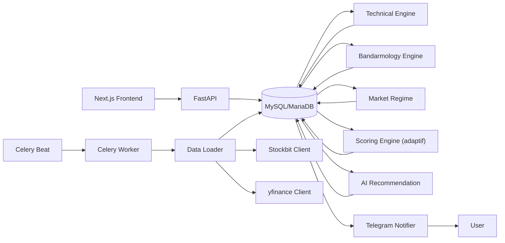

# Architecture

## Komponen

## Data flow harian (EOD)
1. Celery beat menjadwalkan `run_daily_pipeline` (17:30 WIB weekday).
2. Hitung market regime dari IHSG (`^JKSE` via yfinance) → `market_regimes`.
3. `run_full_data_load` mengisi ulang harga + broker flow per ticker (watchlist
   atau top-N IDX).
4. Pipeline per ticker:
   - `load_prices` → `daily_prices` (Stockbit, fallback yfinance).
   - `load_bandar_flow` + `load_foreign_flow` → broker/foreign flow.
   - `compute_technical` → `technical_indicators` (6 metode).
   - `compute_bandar` → `bandarmology_signals` (6 label).
   - `compute_score` → `scores` (composite + fase + dominant factors).
   - `generate_recommendation` → `recommendations` (DeepSeek).
5. `send_daily_digest` mengirim ringkasan top screener + recommendation ke Telegram.

## Skema database
Lihat model di `backend/app/models/`:
- `stocks`, `daily_prices`, `technical_indicators`, `bandarmology_signals`
- `foreign_flows`, `market_regimes`, `stock_profiles`
- `scores`, `recommendations`, `screener_runs`, `screener_results`
- `stockbit_tokens`, `telegram_settings`, `settings`, `watchlist_items`
- `pipeline_runs` untuk status, progress, result, dan error Celery task

Migrasi dikelola oleh Alembic (`backend/alembic/`).

## Modul yang dapat diperluas
- Technical: tambah modul di `app/services/technical/` dan daftarkan di `REGISTRY`.
- Bandarmology: tambah modul di `app/services/bandarmology/` dan daftarkan di `REGISTRY`.
- AI provider: implementasi `app/services/ai/base.py` dan set `AI_PROVIDER`.
- Notifier: tambah provider di `app/services/notifier/` (email/WhatsApp untuk v2).

## Keamanan
- Stockbit token disimpan terenkripsi (Fernet) di `stockbit_tokens.encrypted_token`.
- `ENCRYPTION_KEY` di-load dari env; rotasi = re-encrypt manual.
- JWT `exp` dibaca otomatis; token expired atau respons 401 dinonaktifkan.
  Dashboard menampilkan banner dan `last_error` untuk memandu user re-input.
